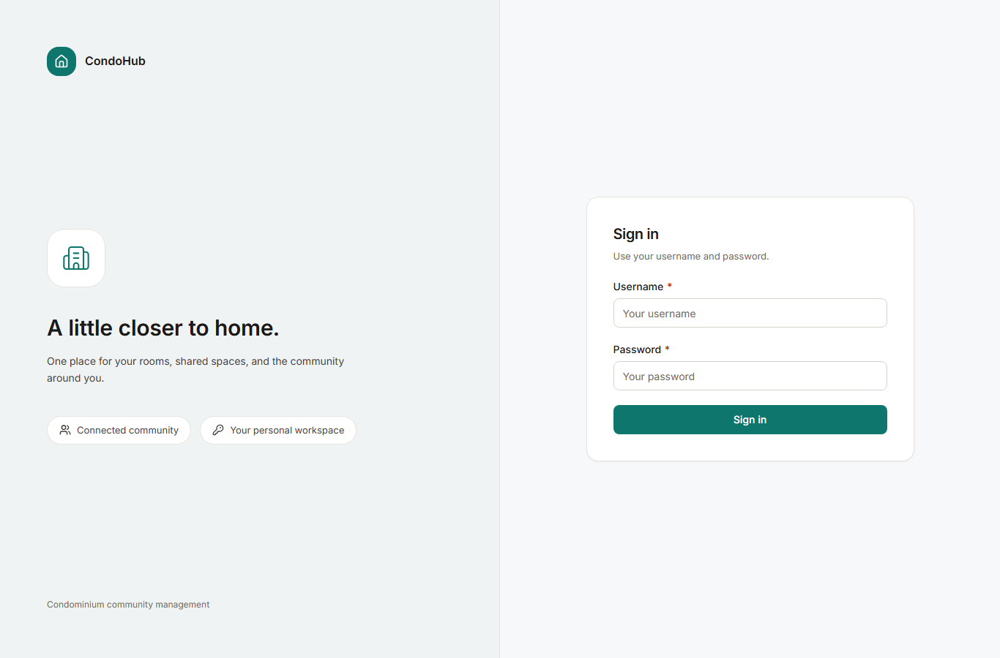

# Development

## Prerequisites

* Node.js (any recent LTS) and `pnpm@10.26.1` (the repo pins its package
  manager).
* Access to a Supabase project (Postgres plus Storage with S3 API) for the
  development database. There is no local-database setup; migrations and seeds
  target `DATABASE_URL` directly.

## First-time setup

```bash
pnpm install
cp .env.example .env.local   # then fill in real values; see below
pnpm db:migrate
pnpm db:seed:bootstrap       # creates username `admin`, prints a one-time password
pnpm dev                     # serves Next.js + Socket.IO on $PORT (default 3000)
```

Open `http://localhost:3000/login` and sign in as `admin`. The bootstrap
account has `mustChangePassword` set, so the first login redirects to
`/change-password`.



Never run `next dev` directly. Both `pnpm dev` and `pnpm start` launch the
custom server in `src/server/index.ts`, which hosts Next.js and Socket.IO on
the same port. Never commit `.env.local`; `.env.example` carries names only.

## Environment variables

All names from `.env.example`. Values live only in `.env.local` (gitignored)
and are never pasted into chat, logs, reviews, or screenshots.

| Variable | Purpose |
|---|---|
| `NODE_ENV` | `development` locally. Seeds and ops scripts refuse to run when this is `production`. |
| `PORT` | Port for the custom server (default 3000). |
| `APP_BASE_URL`, `BETTER_AUTH_URL` | Public base URL of the app, used for links and auth callbacks. |
| `BETTER_AUTH_SECRET` | Session signing secret. Generate with `openssl rand -hex 32`. |
| `DATABASE_URL` | Postgres connection string (Supabase pooler format). Pool size is capped at 5. |
| `MIGRATION_DATABASE_URL` | Optional direct connection for migrations; falls back to `DATABASE_URL`. |
| `S3_ENDPOINT`, `S3_REGION`, `S3_BUCKET`, `S3_ACCESS_KEY_ID`, `S3_SECRET_ACCESS_KEY` | Supabase Storage reached through its S3-compatible API. |
| `JOB_TRIGGER_SECRET` | Shared secret for the internal job endpoints (`generate-invoices`, `sweep-orphans`). |
| `PROJECT_TIMEZONE` | Business timezone. Defaults to `Asia/Bangkok`; keep it unless the whole project moves. |
| `LOG_LEVEL` | `debug` locally, `info` or higher elsewhere. |
| `SEED_ENABLED` | Must be `true` for any seed or ops script to run. Never enable in production. |

## Everyday commands

| Command | What it does |
|---|---|
| `pnpm dev` / `pnpm start` | Run the custom server (dev / prod mode of the same entrypoint). |
| `pnpm typecheck` | `tsc --noEmit`. Strict mode with `noUncheckedIndexedAccess`. |
| `pnpm build` | `next build`. Must pass before any change is considered done. |
| `pnpm test` | Vitest unit suite (400 tests, 58 files). Domain policy tests sit next to the code they cover as `*.test.ts`. |
| `pnpm test:watch` | Same suite in watch mode. |
| `pnpm e2e` | Playwright suite in `e2e/`. Needs a running production server, `TEST_BASE_URL`, `E2E_RUN_ID`, and `E2E_ADMIN_*` credentials (see below). |
| `pnpm db:generate` | Emit a migration from schema changes. Review the SQL, then apply. |
| `pnpm db:migrate` | Apply pending migrations in `drizzle/`, one at a time. Additive only; never edit a migration already applied to the shared database. |

## Database workflow

Migrations live in `drizzle/` (`0000_001-init.sql` through
`0014_scheduled-rental-cancellation.sql`). Drizzle config reads eleven schema
inputs covering every module plus the shared `audit`, `jobs`, and
`idempotency` tables. Because the pooler forbids advisory locks, migrations
must never rely on them; keep each migration small, additive, and applied
alone.

Seed and operations scripts all take the same guards from
`scripts/seed-common.ts`: they abort unless `SEED_ENABLED=true` and
`NODE_ENV` is not production, and run-scoped scripts require
`--run <RUN_ID>` (letters, digits, dashes).

| Script | Purpose |
|---|---|
| `db:seed:bootstrap` | Idempotent first admin (`admin`). Safe to re-run; it only ensures the account exists and is an admin. |
| `db:seed:e2e --run <id>` | Full property scenario for E2E (also used by Playwright `global-setup`). |
| `db:seed:scenario --run <id>` | Same scenario without the E2E admin provisioning. |
| `db:seed:e2e-admin` | Provisions a one-off admin for the E2E run (`E2E_ADMIN_USERNAME`, default `e2eadmin`) and prints its password. |
| `db:seed:reset --run <id>` | Deletes every row and S3 object for a run namespace, in dependency order. Verifies zero residue. |
| `billing:ops` | Billing probes and repairs: `issue-event`, `probe-review`, `probe-fee-owners`, `probe-payments`, `probe-turnover`, `probe-audit`, `probe-payee`, `add-member`, and others. Emits JSON. |
| `maintenance:ops` | Read-only ticket probes (`probe-ticket`, `probe-recipients`, `probe-history`, `probe-ticket-count`). |
| `chat:ops` | Read-only conversation probes (`probe-conversation`, `probe-message`, `probe-message-count`). |

## Regenerating the documentation screenshots

The images under `docs/images/` are captured from the running app with the
`docs01` demo dataset, not mockups. To reproduce them:

1. Start the production server (`pnpm build && NODE_ENV=production pnpm start`)
   so screenshots are free of development reload artifacts.
2. Seed the demo data: `pnpm docs:seed`. It refuses to run unless
   `SEED_ENABLED=true` and `NODE_ENV` is not production. It prints six
   `username=password` lines; export them for the next step.
3. Capture: `DOCS_BASE_URL=http://localhost:3000 DOCS_TENANT_USER=…`
   `DOCS_TENANT_PASS=… DOCS_OWNER_USER=… DOCS_OWNER_PASS=… DOCS_ADMIN_USER=…`
   `DOCS_ADMIN_PASS=… pnpm docs:shots`.
4. Clean up: `pnpm db:seed:reset --run docs01`, then delete any demo
   announcements by title (the reset matches announcements by run ID in the
   title, and demo titles are realistic on purpose). Verify nothing with the
   `docs01` prefix remains before finishing.

Keep screenshots honest: capture the real app, never edit pixels, and never
include other runs' `E2E-` fixture rows. If a project-wide surface (the
announcement feed, the facility directory) shows foreign fixtures, prefer a
search-filtered view, a detail page, or fresher demo rows that sort on top.

## Testing

Unit tests (`vitest`, 10 s timeout, `src/**/*.test.ts`) cover pure domain
policy: ownership intervals, tenancy overlap, booking quotas, fee math,
turnover resolution, ticket state machines, chat visibility, image rules, and
shared utilities. When a rule changes, its colocated test changes in the same
edit.

End-to-end tests (`e2e/specs/`, organized by area: `auth`, `property`,
`booking`, `billing`, `maintenance`, `chat`, `announcements`, `upload`, `ux`,
`responsive-a11y`) run against the real stack: real Postgres, real S3, real
sockets. `global-setup` seeds a `RUN_ID`-namespaced fixture set and provisions
pool admins; `global-teardown` resets the namespace and asserts nothing
remains. Tests never mock integrations. Responsive checks render at 360, 768,
and 1366 px; overlay audits verify dialogs, menus, focus behavior, and
keyboard paths.

A change is done when `pnpm typecheck`, `pnpm build`, and `pnpm test` are
green, new behavior has unit tests and, where it touches a user flow, E2E
coverage on the real stack with zero residue after the run.

## Code conventions that are enforced in review

* TypeScript strict, no `any`. Money as decimal strings on the wire with
  `"currency": "THB"`; `bigint` satang inside. Dates as ISO-8601; display
  through `Intl` with `Asia/Bangkok`.
* No comments in source, no emojis, no Thai text in UI or code (user-authored
  content excepted). UI copy is English, sentence case, verb plus object.
* Colors only through `src/styles/tokens.css` (`--ui-*` bridged to Tailwind v4
  `@theme inline`). Light theme only; no `dark:` variants, no hex codes in
  `.tsx` files. Icons are lucide only.
* Motion is opacity and transform only, 100 to 250 ms ease-out, honoring
  `prefers-reduced-motion`.
* Forms use react-hook-form plus Zod with `noValidate`, field-level `role=alert`
  errors and `aria-invalid`, focus moved to the first invalid field, a
  server-error alert, loading state on the submit button, a toast on success,
  and `router.refresh()` or `push()`. Mutations send `Idempotency-Key`.
* Every element E2E touches carries `data-testid="<screen>-<element>"` in
  kebab case. Test IDs are a contract: renaming one means updating `e2e/`
  first and re-running the suite.
* Errors use frozen `§2.4` codes only (see the error table in the API section
  of the user guide), and private-resource denial is a 404, never a 403.
  Never invent routes, codes, or columns for backend slices without an ADR.
