# User guide

CondoHub serves one residential project: its administrator, its owners, and
the people living in its rooms. This guide describes what each role can do
and how the core workflows behave. All screenshots in this guide were taken
from the running application.

## Roles

| Role | How you get it | What it means |
|---|---|---|
| System admin | Created by another admin or the bootstrap seed | Manages buildings, rooms, facilities, users, announcements, project billing, and the common-area maintenance inbox. Explicitly locked out of private-owner repairs and private rent: those never appear in admin lists, counts, or searches. |
| Private owner / co-owner | Added to a room by an admin (first owner) or by a current owner (co-owner) | Manages their own rooms: tenancies, members, rent settings, private repairs, and turnover reviews. Owners are equals; only an admin can transfer or remove ownership. |
| Resident (main / sub) | Added to a room tenancy by whoever manages it | Books facilities, reports repairs, pays bills, chats in their rooms, reads announcements. Main members can manage same-room membership; sub members cannot. |
| Former resident / former owner | Left automatically when a tenancy, membership, or ownership interval ends | Keeps read-only access to their own history (past invoices, tickets they reported, turnover they are responsible for) and nothing else. |

There is no self-registration. Every account is provisioned by someone already
responsible for the room, starts with a one-time password, and must set its
own password at first login. Suspended accounts cannot sign in.

## Everyday workflows

### Home

After login, residents land on a dashboard: amounts owed with due dates, rent
to collect (owners), open repair requests, upcoming facility bookings, and the
latest community updates. Admins land on the building directory instead.

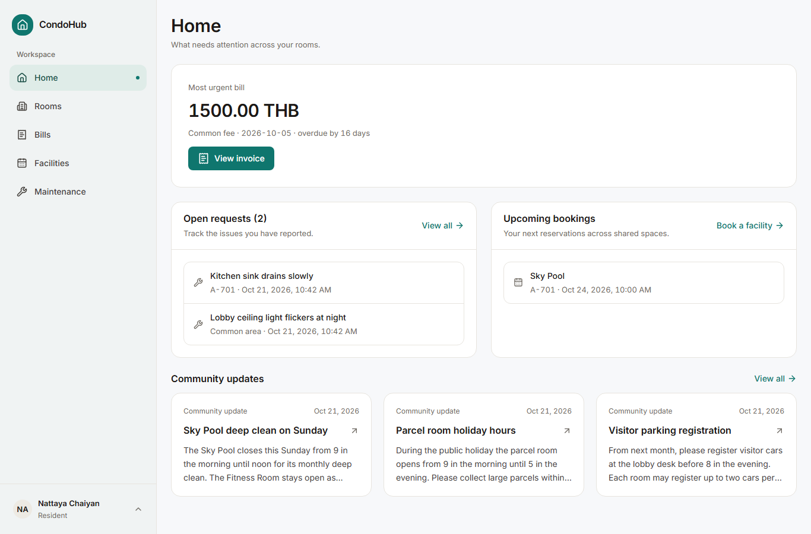

### Rooms and people

`Rooms` lists every room the signed-in account can see. A room page shows
current owners, current members, rental status, and links into bookings, chat,
and rental management.

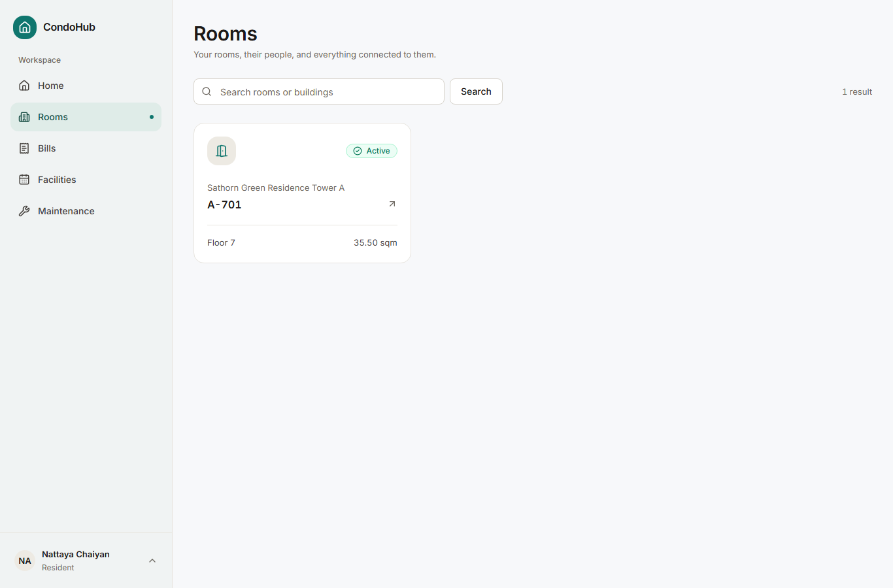 Ownership changes (assign, transfer, remove, correct)
are admin actions; adding a co-owner or a tenant is done by the room's current
owner from the room itself. Memberships and tenancies end explicitly; history
stays readable to the people it concerned.

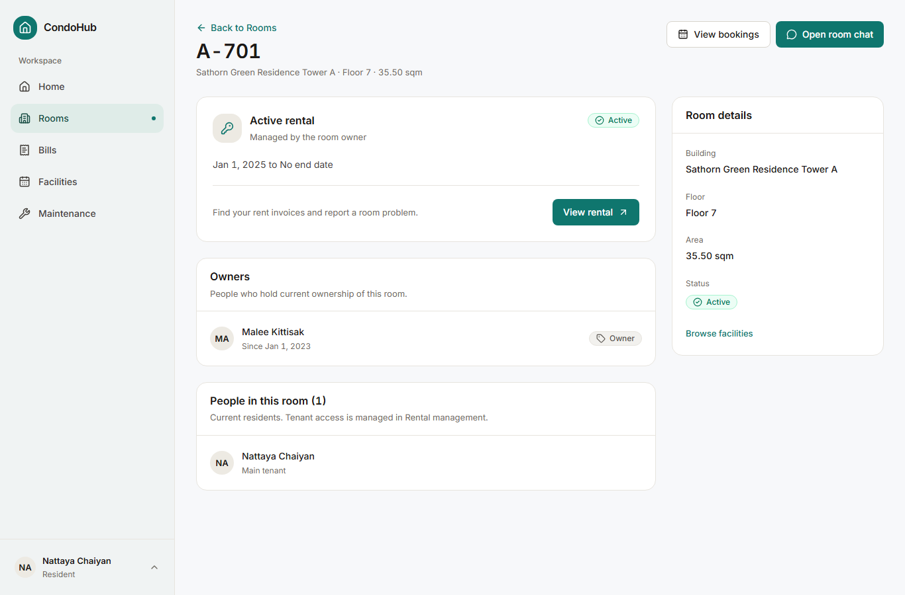

Owners run the rental for each room from its rental workspace: tenants and
dates, rent and payments, and room repairs each have a tab.

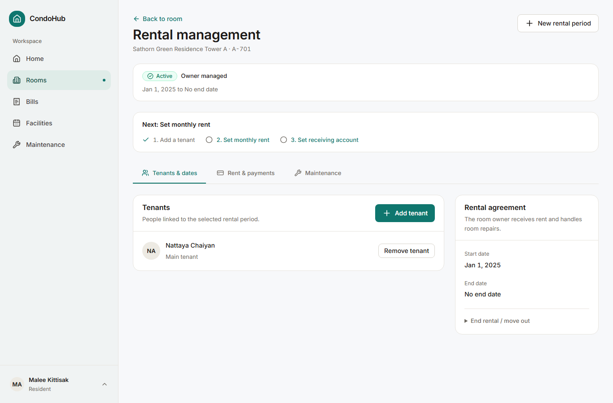

### Rent and bills

`Bills` separates money owed (payable) from money to collect (receivable).
Opening an invoice shows the amount breakdown, the project's or owner's
receiving account, the payment history, and, for reviewers, approve and
reject actions on submitted slips. Paying means submitting a transfer slip
image (exactly one per submission); the reviewer records the approved amount,
which may be partial, and the invoice moves to partially paid or paid.
Months in which a room changed tenants mid-cycle wait in the turnover queue
until the responsible owner resolves them: issue one invoice per tenancy with
an explicit due date per invoice, or record no charge with a reason.

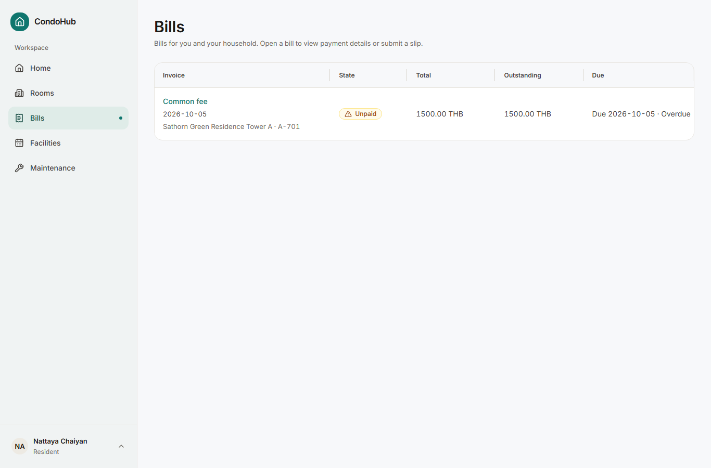

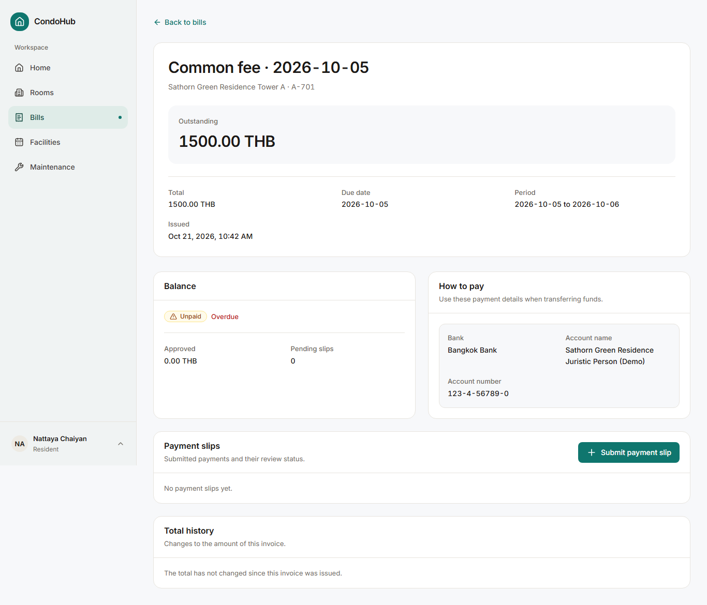

### Facilities

`Facilities` shows what can be booked. Each facility page shows opening hours,
a day picker with availability, per-room quota usage, and a slot grid;

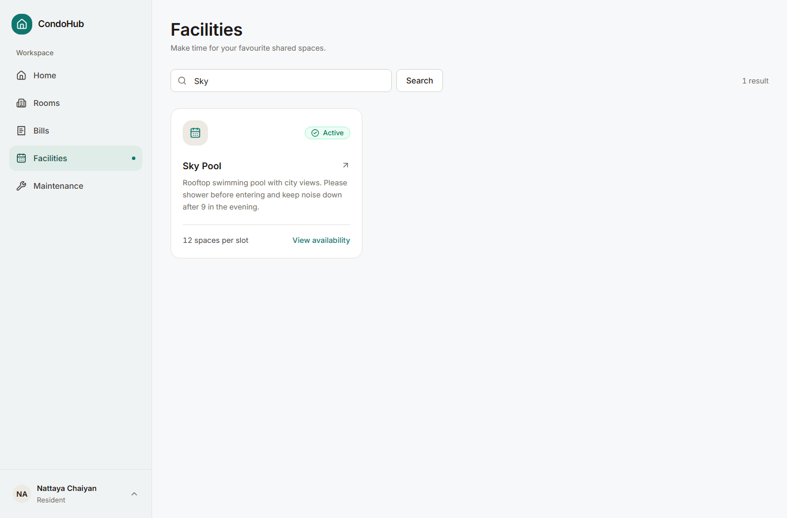
booking multiple slots is all-or-nothing. Cancelling before start frees the
slot but still consumes quota unless an admin refunds it. Admins can close
facilities for windows of time and change booking rules through a previewed,
version-checked configuration change.

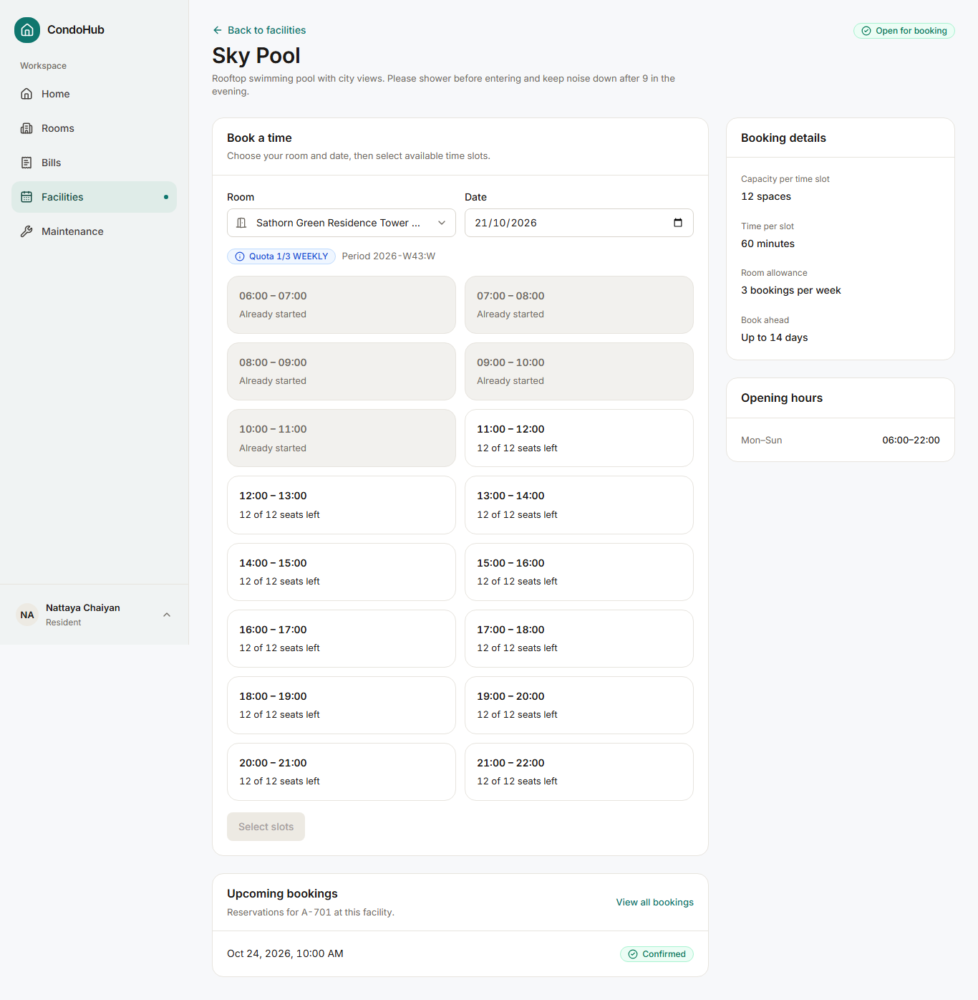

### Repairs

Anyone can report a common-area issue without choosing a room. Room issues go
to whoever manages the room: the admin for project-managed rooms, the room's
owners for privately managed rooms. Reporters can add photos (up to five) and
comment; only the responsible handler moves the ticket forward, and reporters
can only cancel while it is still pending or waiting for information.
Completed, rejected, and cancelled tickets are terminal and read-only; a new
problem gets a new ticket linked by context, never a reopened one.

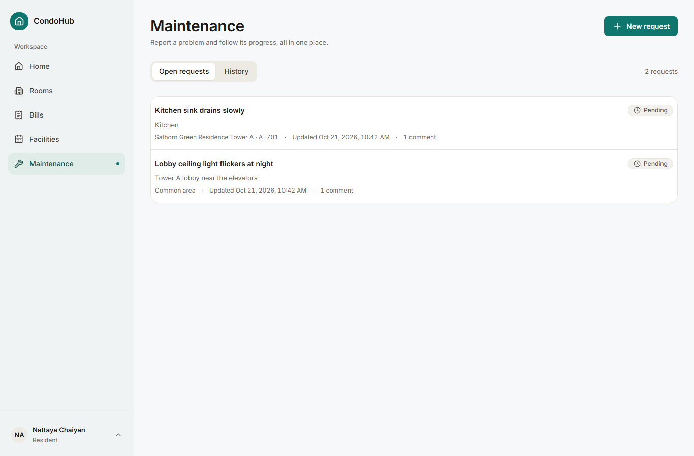

The management team works the same tickets from the maintenance inbox, with
handler transitions and the full history on the ticket detail page.

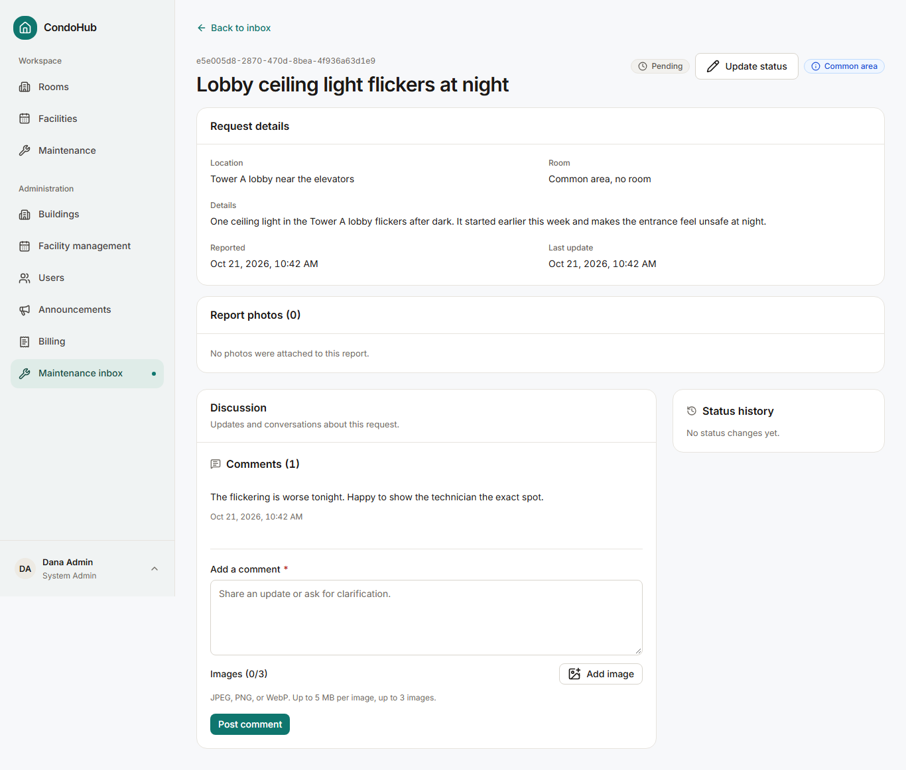

### Announcements and chat

Announcements are project-wide notices with optional images, published
immediately or scheduled; hidden ones stay visible to admins for the record.
Each room has one continuous conversation that survives tenant turnover:
current residents and admins can read and write, owners are hidden while a
tenancy is active, and former residents lose access to anything sent after
they left. Message delivery is persistence-first with live refresh on top.

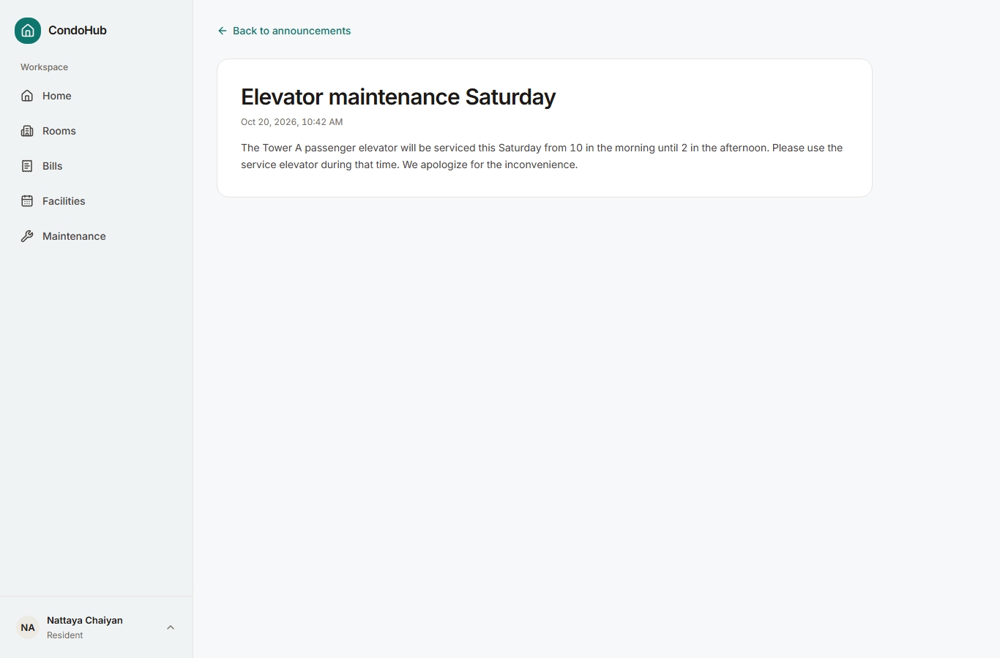

### Administration console

Administrators manage the building structure (floors and rooms per building),
users, announcements, facilities, project billing, and the maintenance inbox
from `/admin`. Billing groups events, invoices, turnover reviews, payment
settings, and job runs under one section.

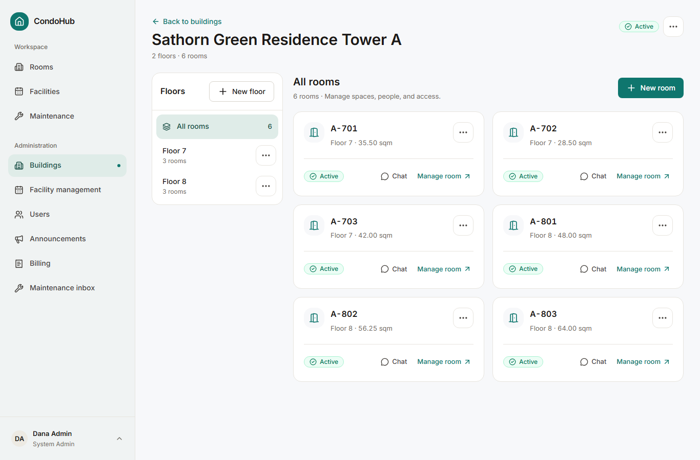

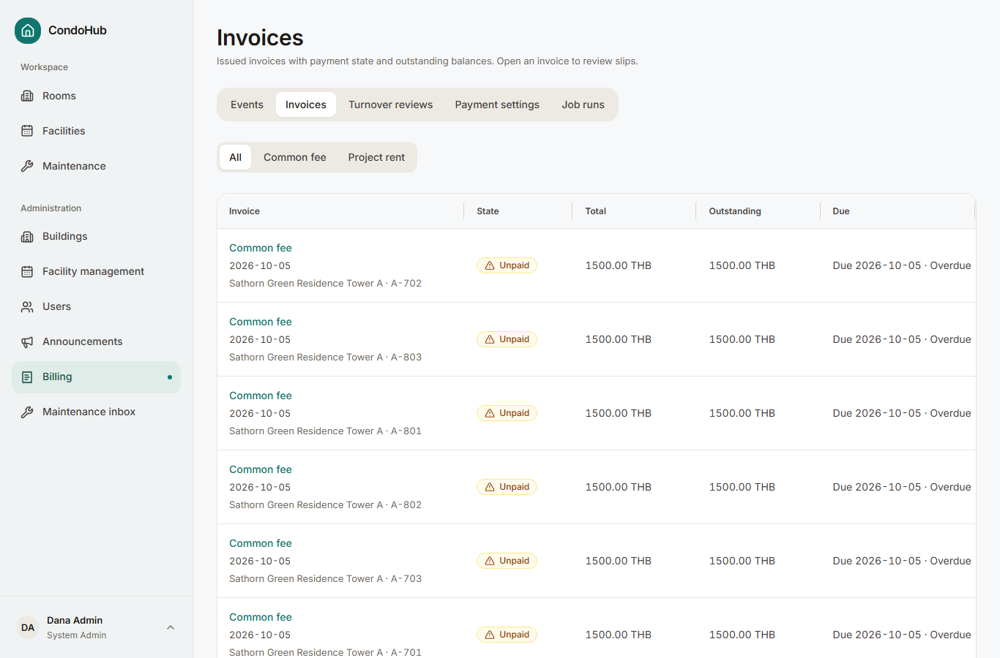

## API overview

The API is JSON over HTTPS under `/api`, UTF-8 throughout. Success answers
are `{ data, meta? }`; failures are
`{ error: { code, message, fieldErrors?, requestId? } }`. Dates are ISO-8601,
money is a decimal string with `"currency": "THB"`, and lists are paginated
with `page`/`pageSize` (default 20, maximum 100; chat uses a `before` cursor,
default 30, maximum 50). Mutating calls accept an `Idempotency-Key` UUID and
answer `409` with a machine-readable code on conflict.

| Area | Endpoints |
|---|---|
| Auth | `GET,POST /api/auth/[...all]`, `POST /api/auth/change-password` |
| Rooms and people | `GET /api/rooms`, `GET /api/rooms/[id]`, `POST /api/rooms/[id]/accounts`, `POST /api/rooms/[id]/co-owners`, `POST /api/rooms/[id]/members`, `PATCH /api/rooms/[id]/members/[membershipId]`, `POST /api/rooms/[id]/tenancies`, `PATCH /api/rooms/[id]/tenancies/[tenancyId]`, plus `POST/PATCH/DELETE /api/admin/buildings…`, `/api/admin/floors…`, `/api/admin/rooms…` with disable, owner, and ownership actions |
| Facilities and bookings | `GET /api/facilities`, `GET /api/facilities/[id]/slots?date=`, `GET /api/facilities/[id]/quota`, `POST /api/facilities/[id]/bookings`, `GET /api/bookings`, `POST /api/bookings/[id]/slots/[slotId]/cancel`, plus admin facility, closure, booking, and config preview/commit endpoints |
| Billing | `GET /api/invoices`, `GET,PATCH /api/invoices/[id]`, `GET /api/invoices/[id]/payments`, `POST /api/invoices/[id]/submissions`, `POST /api/payment-submissions/[id]/approve`, `POST /api/payment-submissions/[id]/reject`, `GET /api/billing/turnover-reviews`, `GET /api/billing/turnover-reviews/[id]`, `POST /api/billing/turnover-reviews/[id]/resolve`, `PUT /api/admin/billing/payment-settings`, `PUT /api/rooms/[roomId]/payment-settings`, `PUT /api/rooms/[roomId]/rent-settings`, `POST /api/rooms/[roomId]/rent-invoices`, common-fee event create/issue/cancel/list, job-run reads, and the internal `generate-invoices` trigger |
| Repairs | `GET,POST /api/maintenance`, `GET /api/maintenance/eligible-rooms`, `GET,PATCH /api/maintenance/[id]`, `POST /api/maintenance/[id]/comments` |
| Announcements | `GET /api/announcements`, `POST /api/admin/announcements`, `GET,PATCH,DELETE /api/admin/announcements/[id]` |
| Chat | `GET,POST /api/rooms/[roomId]/messages` |
| Images | `POST /api/images/intents`, `POST /api/images/[id]/complete`, `GET /api/images/[id]/access`, plus the internal orphan sweep |
| Platform | `GET /api/health` |

## Error codes

Every failure carries one of these codes. Codes are frozen: clients can rely
on the set never growing without an ADR.

| Code | HTTP | Meaning |
|---|---|---|
| `AUTH_REQUIRED` | 401 | No valid session. Sign in again. |
| `FIRST_LOGIN_PASSWORD_CHANGE_REQUIRED` | 403 | Set a new password before continuing. |
| `ACCESS_DENIED` | 403 | The action is not allowed for this account. |
| `RESOURCE_NOT_FOUND` | 404 | Missing, or hidden because the account may not see it. |
| `VALIDATION_ERROR` | 400 | Input rejected; see `fieldErrors`. |
| `ROOM_ACCESS_REVOKED` | 403 | Room access ended mid-session. Reload to continue. |
| `BOOKING_SLOT_UNAVAILABLE` | 409 | The slot was taken or closed. Pick another time. |
| `BOOKING_QUOTA_EXCEEDED` | 409 | Room quota for the period is used up. |
| `INVOICE_ALREADY_PAID` | 409 | The invoice was paid while the request was open. Reload. |
| `PAST_DUE_DATE_CONFIRMATION_REQUIRED` | 400 | Confirm the past due date explicitly, then resubmit. |
| `PAYMENT_ALREADY_REVIEWED` | 409 | Another reviewer decided first. Reload. |
| `PAYMENT_APPROVED_AMOUNT_EXCEEDS_OUTSTANDING` | 409 | The approved amount is more than the balance. Correct it. |
| `PENDING_PAYMENT_EXISTS` | 409 | One pending submission per invoice; wait for review. |
| `VERSION_CONFLICT` | 409 | The record changed underneath. Reload and retry. |
| `CONFIG_IMPACT_CHANGED` | 409 | The facility config moved while previewing. Review the new impact. |
| `FILE_NOT_ALLOWED` | 400 | Only JPEG, PNG, and WebP images are accepted. |
| `FILE_TOO_LARGE` | 413 | Over the byte cap (10 MB slips, 5 MB others). |
| `RATE_LIMITED` | 429 | Too many requests. Wait and retry. |
| `INTERNAL_ERROR` | 500 | Something failed server-side. Retry; the `requestId` helps support. |

## Limits worth knowing

* Usernames are 3 to 30 characters of lowercase letters, digits, underscore,
  and dot. Passwords are at least 12 characters. Login allows 5 attempts per 15 minutes.
* Chat messages hold 20,000 characters and at most one image each.
* Tickets accept 5 photos at creation and 3 per comment. Announcements accept
  5 images. Payment submissions carry exactly one slip image.
* Invoice lists page at 20 items; rooms and facilities at 12; chat loads the
  newest 30 messages and pages backwards.
* One-time charge issuance confirms its room audience once, then issues in
  batches of 25 with safe retry.
